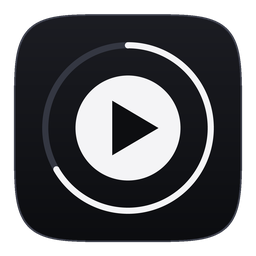

<p align="center"></p>

<h1 align="center">Pulse</h1>

<p align="center">A tiny YouTube player. One ~3.5 MB app, no browser.</p>

- Search, or paste any YouTube link
- Video or audio only; the quality follows your connection
- Queue, playlists, shuffle, repeat
- Keeps playing when the window is minimised

## Install

1. Download Pulse for your system from [Releases](../../releases/latest).
2. Install mpv and ffmpeg:
   - macOS: `brew install mpv ffmpeg`
   - Windows: `winget install mpv` and `winget install ffmpeg`
   - Linux: the `.deb` installs them; otherwise `sudo apt install mpv ffmpeg`
3. Install [deno](https://deno.com), which YouTube lookups need. Pulse fetches yt-dlp by itself.

macOS says the app is damaged? It isn't notarized: run `xattr -dr com.apple.quarantine /Applications/Pulse.app`.

## When YouTube acts up

- Videos stop loading: **Settings → Update yt-dlp**.
- "Sign in to confirm you're not a bot": Pulse can use a browser where you're signed in to YouTube.
  Off by default; [what it does](docs/how-it-works.md#sign-in).

## Build

```sh
cargo run --release
```

`scripts/build-macos.sh`, `scripts/build-linux.sh` and `scripts/build-windows.ps1` put installers in `dist/`.
A push to `main` releases the version in `Cargo.toml` if it has no release yet.

More: [how it works](docs/how-it-works.md).
